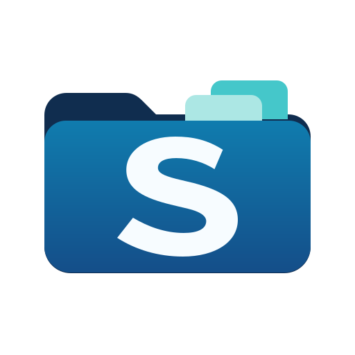
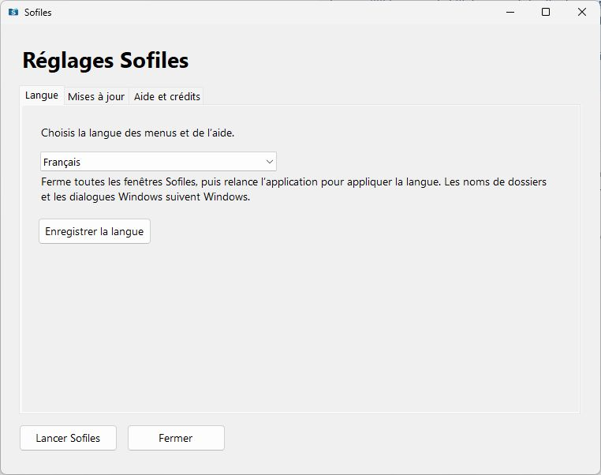
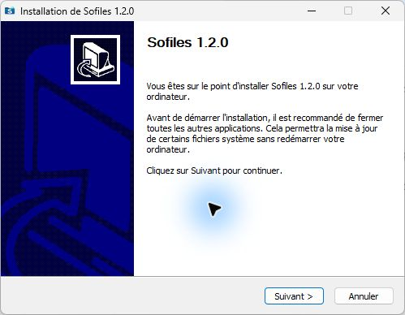

<p align="center">
  
</p>

# Sofiles

Des onglets et des favoris dans l’Explorateur de fichiers Windows.

Sofiles regroupe plusieurs dossiers dans une même fenêtre et permet de retrouver ses emplacements favoris. Les réglages et l’aide sont disponibles en français, en anglais et en allemand.



## Télécharger

[Télécharger Sofiles 1.2.0 pour Windows](https://github.com/sofianerm/sofiles/releases/download/v1.2.0/Sofiles-Setup-1.2.0.exe)

La version 1.2.0 est une préversion publique de test. Les fichiers et notes de version sont sur la [page de la préversion](https://github.com/sofianerm/sofiles/releases/tag/v1.2.0).

Prérequis :

- L’Explorateur classique de Windows. La configuration testée sous Windows 11 utilise SwitchExplorer pour activer ce mode.
- .NET Framework 4.8 pour les outils de réglages.

Consulter les [limites de sécurité](SECURITY.md) avant d’utiliser cette préversion.

## Installer et lancer

1. Activer l’Explorateur classique si nécessaire, puis fermer les fenêtres Sofiles déjà ouvertes avec le menu Quitter.
2. Exécuter `Sofiles-Setup-1.2.0.exe` et choisir la langue de l’installation.
3. Installer Sofiles pour le compte Windows courant. Le programme d’installation propose les raccourcis et les options de lancement.
4. Lancer Sofiles depuis le menu Démarrer. Les réglages et la désinstallation sont accessibles depuis ce même menu.



Pour changer de langue, ouvrir les réglages Sofiles, enregistrer le choix, puis fermer toutes les fenêtres Sofiles et relancer l’application. Les noms de dossiers et les dialogues Windows suivent la langue de Windows.

La désinstallation conserve le profil et les favoris.

## Fonctions

- Ouvrir plusieurs dossiers dans les onglets d’une même fenêtre.
- Garder des emplacements dans les favoris.
- Choisir le français, l’anglais ou l’allemand pour les menus, les réglages et l’aide locale.
- Consulter l’aide et les informations de version depuis les réglages.
- Choisir de vérifier les mises à jour au lancement, lorsqu’un canal est configuré.

La vérification automatique des mises à jour est facultative. Le gestionnaire affiche la version disponible et ses changements avant de proposer le téléchargement. Il vérifie la signature du manifeste et l’empreinte SHA-256 du fichier, puis demande l’accord de l’utilisateur avant d’ouvrir le programme d’installation. Les versions peuvent aussi être téléchargées depuis [GitHub Releases](https://github.com/sofianerm/sofiles/releases).

Un don PayPal facultatif de 20 CHF est proposé dans les réglages. L’utilisation de Sofiles ne nécessite aucun paiement.

## Limites connues

- L’Explorateur moderne de Windows 11 n’a pas été validé.
- Le raccourci Ctrl+T n’a pas été vérifié dans le moteur natif.
- Quelques messages d’erreur natifs restent en français.
- L’examen de sécurité du moteur historique reste à compléter.

## Code et compilation

Les nouveaux outils sont écrits en C# pour .NET Framework 4.8. Les scripts Python préparent les ressources et la distribution. La version 1.2.0 utilise un programme d’installation NSIS 3.13 en français, en anglais et en allemand.

Le dépôt contient les sources des outils et les scripts de construction. Les binaires du moteur tiers doivent être fournis séparément pour compiler une distribution complète.

```powershell
python -m pip install Pillow pefile
python tools/build_sofiles_product.py
python tools/test_sofiles_product.py
```

Les prérequis, les fichiers d’entrée et les limites des tests sont détaillés dans [Compiler Sofiles](docs/BUILD.md).

## Contribuer

Les rapports de bugs, corrections et traductions sont les bienvenus. Consulter [CONTRIBUTING.md](CONTRIBUTING.md) pour préparer une contribution et [les issues](https://github.com/sofianerm/sofiles/issues) pour signaler un problème reproductible.

Contact : [so.messaoudi@gmail.com](mailto:so.messaoudi@gmail.com). Pour une vulnérabilité, suivre la [procédure de signalement privé](SECURITY.md).

## Licence

Le code des nouveaux outils et scripts Sofiles est sous [licence MIT](LICENSE).

Le moteur historique est un composant binaire tiers propriétaire. Son code source n’est pas disponible dans ce dépôt et la licence MIT des outils ne s’y applique pas. Ses conditions et celles des autres composants tiers sont répertoriées dans [licenses/NOTICE.md](licenses/NOTICE.md). Les distributions conservent leurs notices et licences.
